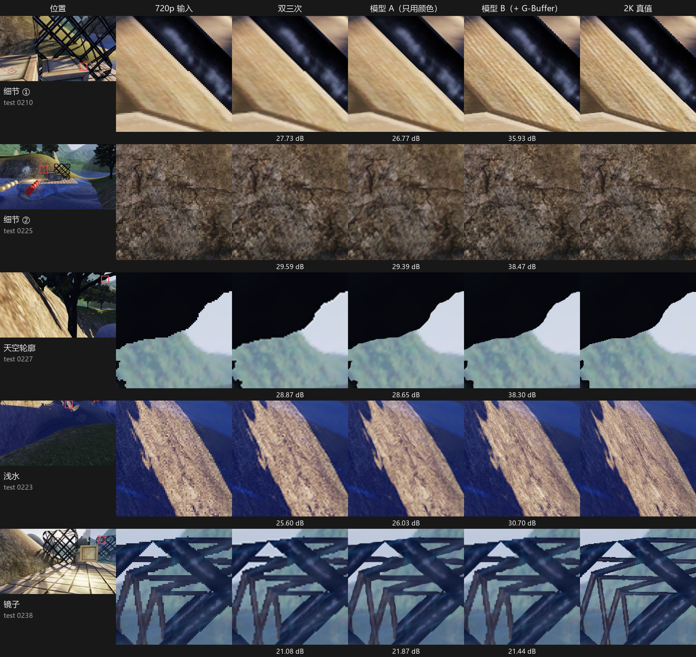
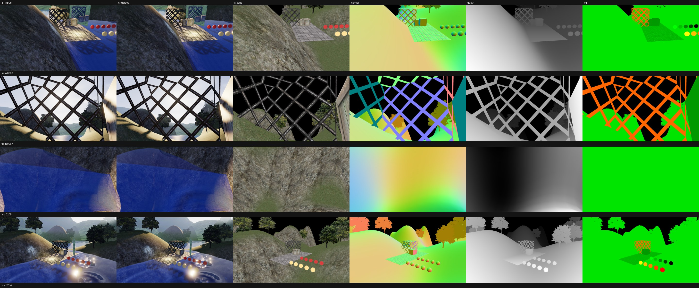
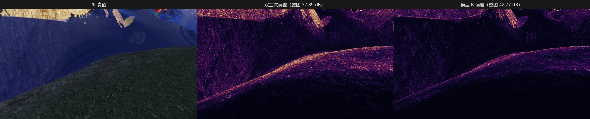
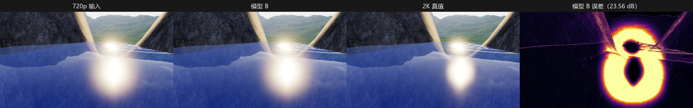
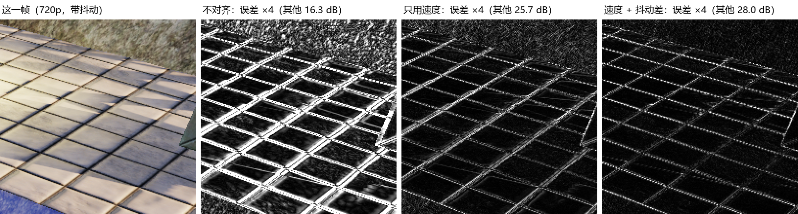
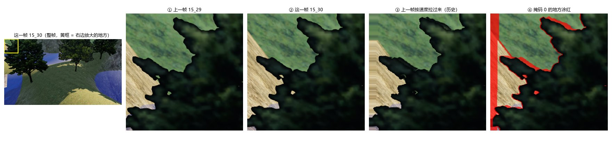
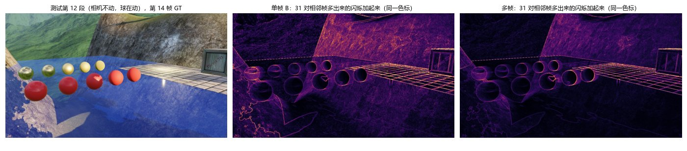
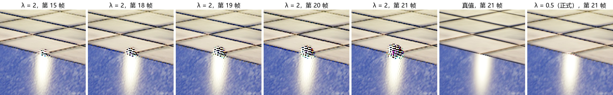

之后不准备继续开发这个项目力
准备在Unity里面实现一个自己的插件 迷你DLSS 5！

# NeuralSR：G-Buffer 引导的 2× 超分（单帧 → 多帧）

用自己写的 DX12 延迟渲染器导出数据，训练一个很小的 CNN，把 720p 的渲染结果放大到 2K（2560×1440）。
对比两种输入：**只用颜色**（模型 A），**颜色 + 2K 的 G-Buffer**（模型 B）；质量和耗时都量了。



**这不是 DLSS：**

- 第一阶段是单帧：没有运动矢量、没有历史帧；第二阶段（后文的表 4）加上了运动矢量和上一帧的输出，但网络很小（6.8 万参数）；
- 只有一个场景：测试集换了机位方向，但物体都是训练里见过的；
- 只在 PyTorch 里离线评估，没有接回渲染器。

## 思路

在我的渲染器里，2K 下 G-Buffer Pass 只要约 0.25 ms，贵的是后面的着色（光照、SSAO 等，SSAO 一项就要 0.93 ms，见"代价"）。
所以只把着色降到 720p，G-Buffer 照样按 2K 画，交给网络当提示：基础色里有贴图细节，法线和深度里有几何边缘。
用全分辨率 G-Buffer 引导超分的思路，可参考 FuseSR（SIGGRAPH Asia 2023）。

## 数据

- 渲染器：LearnDX12（延迟渲染 + SSAO + Bloom + ACES 色调映射），同一个机位渲一次 720p、一次 2K。
- 200 张训练，40 张测试（33 个训练没见过的方向 + 7 个 demo 机位）。
- 每个样本：720p 成品画面（输入）、2K 成品画面（目标）、2K 的 G-Buffer——基础色 3 + 法线 3 + 金属度/粗糙度 2 + 1/深度 1 = 9 通道。
- 测试集每个像素标了区域：其他（G-Buffer 里有的不透明物体）/ 天空 / 水面 / 镜子，像素占比 61.4% / 10.0% / 27.6% / 1.0%。
  水面、镜子里的倒影、天空都是前向画的，不在 G-Buffer 里；水面位置的 G-Buffer 是水底的地形。

详见 [data/README.md](data/README.md)。



## 网络

```
输入   A：720p 颜色（3 通道）
       B：720p 颜色（3）+ 2K G-Buffer 经 PixelUnshuffle(2) 变成 720p 大小（9 × 4 = 36）= 39 通道
主体   Conv 5×5 → 32，ReLU
       Conv 3×3 → 32，ReLU
       Conv 3×3 → 32，ReLU
       Conv 3×3 → 12
输出   PixelShuffle(2)：12 通道 720p → 3 通道 2K，当作"补充细节"
       + 双三次放大的 720p 颜色
```

参数量：A 24,396，B 53,196。网络只学"双三次还差多少"（残差），去掉残差时训练很不稳定。

## 训练

- L1 损失，Adam，学习率 1e-3，batch 16，每块 720p 64×64（对应 2K 128×128），20000 步，固定随机种子。
- RTX 5060 Laptop：A 351 秒，B 375 秒。训练数据存成不压缩的 `.npy`，用 mmap 只读裁出来的那一块，8 个 DataLoader worker；
  GPU 占用约 37%，瓶颈在读数据。
- 同样设置重跑，结果会有约 0.2 dB 的浮动（GPU 上的运算不是完全确定的）。

## 结果

**表 1**：测试集 40 张（`python eval.py`）。整图 PSNR、SSIM 是每张图各算再平均；分区 PSNR 是所有图里这个区域的像素合起来算。

| 方法 | PSNR | SSIM | 其他 | 天空 | 水面 | 镜子 |
|---|---|---|---|---|---|---|
| 双三次 | 31.37 | 0.9289 | 30.22 | 30.31 | 28.35 | 28.70 |
| 模型 A | 31.89 | 0.9354 | 30.70 | 31.68 | 28.42 | 29.59 |
| 模型 B | **34.85** | **0.9739** | **34.13** | **35.37** | 28.55 | 29.33 |

**表 2**：分区 PSNR 按"水面上有没有太阳反光"分成两组再算（`python tools/make_figures.py`）。
有反光的是 0202、0214、0220、0229、0234、0235 这 6 张。

| 测试图 | 张数 | 方法 | 其他 | 天空 | 水面 | 镜子 |
|---|---|---|---|---|---|---|
| 无反光 | 34 | 双三次 | 30.23 | 30.40 | 37.24 | 28.83 |
| 无反光 | 34 | 模型 A | 30.74 | 31.93 | 37.83 | 29.73 |
| 无反光 | 34 | 模型 B | 34.33 | 36.82 | 39.68 | 29.33 |
| 有反光 | 6 | 双三次 | 30.08 | 29.79 | 23.22 | 28.00 |
| 有反光 | 6 | 模型 A | 30.35 | 30.37 | 23.24 | 28.80 |
| 有反光 | 6 | 模型 B | 32.61 | 30.94 | 23.24 | 29.33 |

**局部对比**（本页最上面那张图）：每行是一块 160×160 的 2K 区域，放大 2 倍显示（最近邻），下面是这一块的 PSNR。
前三行是自动挑出的"B 比 A 提升最多"的块；"浅水"那一行能透过水面看到水底地形，地形在 G-Buffer 里；
"镜子"那一行是镜子里的倒影，不在 G-Buffer 里。

**误差图**（test 0223，越亮错得越多，两张用同一色标）：



**太阳反光 + Bloom**（test 0229）：渲染器的 Bloom 固定做 6 级降采样，720p 下每一级的像素更大，
光晕在屏幕上比 2K 的大一圈。网络拿到的输入已经带着这个大光晕，三种方法在这张图上都是 23.56 dB。



## 代价

720p → 2K 放大一次的耗时（fp16，只算 GPU，预热 10 次后取 50 次平均，`python eval.py`）：

| 方法 | 耗时 | 参数量 |
|---|---|---|
| 双三次 | 0.43 ms | 0 |
| 模型 A | 8.34 ms | 24,396 |
| 模型 B | 14.58 ms | 53,196 |

对照渲染器自己的开销：Release 构建，关垂直同步，7 个 demo 机位（p1–p7）的平均。
每个 Pass 用 GPU 时间戳量，每 60 帧取一次平均，丢掉开头 2 次（预热）。

| 项目 | 2K（2560×1440） | 720p（1280×720） |
|---|---|---|
| 阴影图 | 0.07 ms | 0.06 ms |
| 不透明 / G-Buffer | 0.25 ms | 0.08 ms |
| SSAO（遮蔽 + 4 次模糊） | 0.93 ms | 0.23 ms |
| 光照 | 0.34 ms | 0.05 ms |
| Bloom | 0.13 ms | 0.04 ms |
| 其余（天空、镜子、透明、色调映射） | 0.17 ms | 0.04 ms |
| **整帧** | **1.89 ms**（各机位 1.63–2.28） | **0.50 ms**（0.46–0.56） |

## 结论

**1. G-Buffer 很有用，但只对 G-Buffer 里有的东西有用。**
整图 PSNR 从双三次的 31.37 提到 34.85（+3.5 dB），而只用颜色的模型 A 只提升了 0.5 dB，提升基本都来自 G-Buffer。原因有两条：

- 基础色是按 2K 采样的贴图，720p 画面里糊掉的木纹、石头纹理在这里还在（对比图前两行）；
- 深度在物体和天空交界处一个像素之内就跳到 0，轮廓位置能精确到 2K 像素，720p 的颜色只能定位到 2 个像素以内。
  所以天空一列提升最多（30.31 → 35.37）。

镜子里的倒影不在 G-Buffer 里，B（29.33）和 A（29.59）差不多。

**2. 水面整体只提升 0.2 dB，是被 Bloom 拖的，不是 G-Buffer 没用。**
没有太阳反光的 34 张里，水面从 37.24 提到 39.68（+2.4 dB），因为浅水处能透出水底地形，而地形在 G-Buffer 里。
有反光的 6 张里，Bloom 是在 720p 上做的，光晕在屏幕上比 2K 的大，网络拿到的输入本身就和目标对不上，三种方法都只有 23 dB 左右。
这几张图误差特别大，而分区 PSNR 是把所有像素的误差合起来算，于是整列都被拉低了。
修法是把超分放到 Bloom 之前：用光照之后、Bloom 之前的 HDR 图当数据集，放大到 2K 之后再做 Bloom 和色调映射。

**3. 在这个场景里不划算。**
直接按 2K 渲染一帧要 1.89 ms；换成 720p 着色（G-Buffer 仍按 2K 画）大约 0.67 ms，再加上模型 B 放大的 14.58 ms，一共约 15.3 ms，慢了约 8 倍。
网络的耗时只和输出多少像素有关，和场景复杂不复杂无关。只有每个像素的着色都很贵（光线追踪、路径追踪）时，降分辨率省下的时间才可能比网络贵；同时网络本身也必须足够轻。

**4. 和 DLSS 这类方案比，差在四点：**

- 单帧：没有运动矢量和历史帧，拿不到前几帧累积下来的细节；
- 只有一个场景，没有验证泛化；
- 只在 PyTorch 里离线评估，没有接回渲染器；
- 速度差一个数量级：模型 B 放大一次 14.6 ms，DLSS 一般在一两毫秒。

**5. 下一步：**

- ~~改用 Bloom 之前的 HDR 图重新导数据、重新训练，把超分挪到后处理之前（要处理 HDR 值大于 1 的问题）~~ → 已做，见下一节；
- 让网络变轻：中间通道数从 32 减到 16（中间两层的参数量变成 1/4），第一层卷积核 5×5 改成 3×3（这一层剩 9/25），再试 `channels_last` 内存布局，每一步都量质量和耗时；
- ~~再往后做多帧超分：加上运动矢量和历史帧~~ → 已做，见表 4。

## 第二阶段（进行中）：多帧数据，超分挪到 Bloom 之前

### 数据

渲染器加了最简版 TAA 之后，每帧的 Halton 抖动和速度缓冲（相机 + 物体运动）都有了，于是重新导了一套**按连续帧导出的序列**：
16 段 × 32 帧（训练 12 段、测试 4 段，测试段在训练没见过的方向），相机沿 5 种路径动（静止 / 转头 / 横移 / 绕目标 / 前后推），部分段里测试球在动。

- **输入**：720p、带抖动（2× 超分用 32 个相位）的**线性 HDR**，在 Bloom 和色调映射之前读回；加上 720p 的速度缓冲、深度、区域掩码。
- **目标**：2K 下把时间冻住，64 个抖动位置在线性 HDR 里取平均（超采样），不是 TAA 的结果。
- **2K G-Buffer**：和单帧一样的 9 通道，同一时刻不抖地画一帧。

导出前给渲染器补了两处：天空的速度写回速度缓冲（以前只在 TAA 里临时算），抖动相位数跟着超分倍数走（8 × 倍数²）。
细节见 [data/README.md](data/README.md) 的"多帧数据集"。

### 对齐检查

用这一帧的速度把上一帧"拉"过来（backward warping，Xiao et al. 2020 第 3.2.2 节的做法，这里先在 720p 上做），看和这一帧差多少。
测试集 4 段，每段 31 对相邻帧；屏幕空间 PSNR（下面的"屏幕空间"都是：× 曝光 2^EV → ACES → sRGB 编码，和渲染器的色调映射 Pass 一样，不加 Bloom）；上一帧位置出了屏幕的像素不算。

| 用上一帧猜这一帧 | 其他 | 天空 | 水面 | 其他里在动的像素 |
|---|---|---|---|---|
| 不对齐 | 20.45 | 27.41 | 26.03 | 20.08 |
| 只用速度 | 25.38 | 32.30 | 29.99 | 26.33 |
| 速度 + 两帧抖动差 | **28.60** | **33.82** | **31.99** | **29.34** |



- 两帧的抖动不一样，采样点本来就差了亚像素，只用速度会在边缘留下一圈误差，加上抖动差多 3.2 dB。
- 剩下的误差集中在轮廓边：上一帧这里被别的东西挡着（遮挡变化），速度再准也取不到。天空内部（离轮廓 3 像素以上）在转头、横移两段里有 47–50 dB。
- 水面的速度是水底地形的（水面是前向画的），倒影的变化也不在速度里，所以多帧网络要靠区域掩码 / 遮挡掩码少信这些地方的历史。

### 表 3：单帧 HDR 基线

网络和训练设置都和表 1 一样（SRNet，L1，20000 步），只换了数据和空间：
颜色进网络前先过 `log(1 + x)`（HDR 值从 0 到两三百，直接算 L1 会被几个高光像素主导），损失在这个 log 空间算，输出再变回线性 HDR。
测试集 128 帧整图；PSNR、SSIM、分区 PSNR 都在**屏幕空间**算；"log 空间 L1"就是训练时的损失。

| 方法 | PSNR | SSIM | 其他 | 天空 | 水面 | log 空间 L1 |
|---|---|---|---|---|---|---|
| 双三次（在线性 HDR 上放大） | 30.64 | 0.8777 | 27.96 | 38.17 | 34.29 | 0.0035 |
| 模型 A（只用颜色） | 31.35 | 0.8799 | 28.63 | 39.31 | 35.23 | 0.0033 |
| 模型 B（颜色 + 2K G-Buffer） | **33.51** | **0.9419** | **31.10** | **39.53** | **36.78** | **0.0025** |
| *2K 直接画（不抗锯齿），对照* | *39.62* | *0.9893* | *37.03* | *46.34* | *43.12* | *0.0008* |

- 测试集各区域像素占比：其他 44.6%、天空 7.8%、水面 47.6%、镜子 0%（测试段没拍到镜子）。
- 和表 1 不能直接比：数据（序列帧、开了 IBL）、目标（64 次超采样，不是没抗锯齿的 2K）、空间（HDR + 屏幕空间，不是 Bloom 之后的 LDR）都换了。
- 最后一行不是超分，是同一时刻按 2K 不抖地画一帧：它和超采样目标的差别只剩锯齿（39.62 dB）。单帧模型 B 比它低 6.1 dB——多帧要补的就是这一段。
- 按段看（屏幕空间 PSNR，双三次 / A / B）：第 12 段（静止 + 球动）29.78 / 30.62 / 32.87，第 13 段（转头）30.03 / 30.86 / 32.97，第 14 段（横移）31.51 / 32.28 / 34.16，第 15 段（绕目标）31.25 / 31.64 / 34.03。

### 多帧网络

结构参考 FRVSR（Sajjadi et al. CVPR 2018）的循环做法：每一帧把**上一帧的输出**拉过来，当作这一帧的输入之一。

- **拉历史**：上一帧的输出（2K、log 空间）用这一帧的速度做 backward warp。速度双线性放大到 2K，值不变（uv 不随分辨率变）；网络的输出朝着不抖的目标训练，所以两帧之间的抖动差取 0。
- **遮挡掩码**：上一帧的 1/深度也用同一个速度拉过来，和这一帧的比，相对差 ≤ 10%、而且上一帧位置在屏幕里，才算"历史能用"。拿上一帧的目标当完美的历史来测：掩码里 40–47 dB，掩码外只有 12–18 dB，掩码外的像素占 0.2–1.6%。



*（测试第 15 段，相机绕着目标转。③ 最左边一条是上一帧没拍到的地方，warp 只能拿边上的颜色往外拉；树的轮廓旁边是上一帧被树挡着、这一帧露出来的草地，拉过来的还是树。④ 红色是掩码判成 0 的地方。）*

- **网络**：和模型 B 一样的结构，输入多了三样：拉过来的历史（3 × 4）、掩码（1 × 4）、这一帧的抖动（2，铺成两张图），一共 57 通道，67,596 个参数。激活函数是 LeakyReLU(0.1)，原因见下面。
- **训练**：一个样本是同一段里连续 4 帧、同一个 64×64 的裁块（速度换成这个块的 uv）。每个样本从"没有历史"开始一帧一帧跑，历史始终是网络自己上一帧的输出，和推理时一样；梯度穿过历史传回前面几帧（不 detach）。损失 = 每帧 log 空间 L1 的平均。batch 16，Adam 1e-3，10000 步，33 分钟。（这是表 4 里"不加一致性损失"那一行；正式模型在损失里加了一项帧间一致性，见后面的"帧间一致性损失"。）
- **评估**：测试集 4 段整段，每段从第 0 帧（没有历史）一帧一帧跑到第 31 帧。

### 表 4：多帧 vs 单帧

测试集 128 帧，屏幕空间（`python eval_mf.py`；单帧 LeakyReLU 和不加一致性损失的多帧是另外训的模型，用同一套量法）。"闪烁"：用速度把上一帧拉过来，看这两帧之间的变化和目标的变化差多少（只算掩码里的像素，屏幕空间平均绝对差 × 1000）；目标自己是 0。

| 方法 | PSNR | 第 0 帧 | 第 4–31 帧 | 水面 | 新露出来的 | 闪烁 |
|---|---|---|---|---|---|---|
| 双三次 | 30.64 | | | | | 18.03 |
| 单帧 B（ReLU，表 3 那个） | 33.51 | 34.49 | 33.44 | 36.78 | **23.86** | 11.93 |
| 单帧 B（LeakyReLU，重训） | 34.59 | 35.60 | 34.51 | 38.21 | 23.84 | 9.00 |
| 多帧（LeakyReLU，不加一致性损失） | 35.06 | 35.59 | 35.02 | 38.79 | 23.50 | 7.32 |
| **多帧 + 一致性损失（λ = 0.5，正式）** | **35.35** | **35.69** | **35.31** | **38.90** | 23.44 | **6.02** |
| *2K 直接画（不抗锯齿），对照* | *39.62* | | | | | *2.08* |



**1. ReLU 死了一大片。** 多帧网络第一次用 ReLU 训练，5000 步时只比同样步数的单帧高 0.16 dB。同样的设置重训 2500 步来查：第一层 32 个通道里有 20 个在测试块上一个像素都不亮（训练好的单帧 B 只有 5 个），新加的历史、掩码、抖动大多进不了网络。三种设置各训练 2500 步对照：

| 2500 步 | PSNR | 第一层不亮的通道 |
|---|---|---|
| ReLU，学习率 1e-3 | 32.65 | 20 / 32 |
| 学习率降到 3e-4 | 32.78 | 7 / 32 |
| **LeakyReLU(0.1)** | **33.96** | **1 / 32** |

LeakyReLU 把负数乘 0.1 而不是变成 0，斜率不会是 0，通道就死不掉。单帧 B 换成 LeakyReLU 也涨了 1.08 dB，所以表 4 里两行单帧都列出来：**公平的对照是 LeakyReLU 那一行。**

**2. 历史帧本身的贡献。** 激活函数一样、都不加一致性损失时，第 0 帧（多帧也还没有历史）两者一样（35.60 / 35.59）；有了历史以后，PSNR **+0.47 dB**，第 4–31 帧 +0.51，水面 +0.58，闪烁少 **19%**（9.00 → 7.32）。热力图里闪烁集中在球的轮廓、地砖缝、岩石纹理这些高频的边上，多帧整体暗了一截，但边上还是亮的。

**3. 失败案例：新露出来的地方，多帧反而低 0.34 dB。** 这些像素只占第 1–31 帧的 0.90%。一开始猜是掩码外的历史没清零、旧颜色漏了进来，但评估时把掩码外的历史乘 0，只变了 +0.06 dB，所以不是这个原因，还没找到。

**4. 训练设置很敏感。** 同样的网络，换成 128×128 的裁块、batch 4（每步的像素量一样），第一层 32 个通道死了 27 个，5000 步后输出和权重全 0（也就是双三次）一模一样（30.71 dB）。一批里独立的样本少了，梯度忽大忽小，把通道推死了。

**5. 离目标还远。** 比"2K 直接画"低 4.6 dB；闪烁是它的 3.5 倍。~~下一步在损失里加一项帧间一致性~~ → 已做，见下一节：正式模型低 4.3 dB，闪烁是 2.9 倍。

### 帧间一致性损失

表 4 里不加一致性损失的多帧，只要求每一帧各自像目标，没管相邻两帧之间怎么变。所以在损失里加一项：用这一帧的速度，把**上一帧的输出**和**上一帧的目标**都拉过来，要求"输出这两帧之间的变化"和"目标这两帧之间的变化"一样：

```
一致性损失 = 掩码 × |(输出ₖ − 拉过来的输出ₖ₋₁) − (目标ₖ − 拉过来的目标ₖ₋₁)| 的平均      （k ≥ 1，log 空间）
总损失     = (每帧 L1 之和 + λ × 每对相邻帧的一致性损失之和) / 帧数
```

- 比的是"变化"，不是"上一帧本身"：球在动、光在变时，该变的地方照样要变，只罚多出来的变化。只要求和上一帧一样的话，网络会学成"不闪，但不对"。
- 只算掩码里的像素：新露出来的地方没有上一帧可比。
- 表 4 的"闪烁"是同一个量，只是换到屏幕空间、在测试集上算。所以这一项直接在压闪烁。

**表 5：λ 对照。** 每个 λ 训 5000 步（正式模型的一半），随机种子都是 0，其余设置和表 4 一样；测试集 128 帧，屏幕空间。

| λ | PSNR | 第 4–31 帧 | 水面 | 新露出来的 | 闪烁 |
|---|---|---|---|---|---|
| 0 | 34.50 | 34.44 | 37.79 | 23.41 | 8.76 |
| 0.1 | 34.16 | 34.10 | 36.93 | **23.49** | 8.58 |
| **0.5** | **34.73** | **34.68** | **38.24** | 23.44 | 7.25 |
| 1 | 34.48 | 34.43 | 37.82 | 22.90 | **6.43** |
| 2 | nan（发散，见下面的失败案例） | nan | nan | 22.66 | nan |

- 闪烁随 λ 一路下降：8.76 → 8.58 → 7.25 → 6.43，λ = 1 时少了 27%。
- λ = 0.5 的 PSNR 最高（+0.23 dB），闪烁少 17%：画质和稳定这里没有此消彼长。
- λ = 1：PSNR 和 λ = 0 持平，闪烁最低；但新露出来的掉了 0.5 dB。一致性损失只管掩码里的像素，网络把力气挪了过去。
- λ = 0.1 反而低 0.34 dB，比 0 和 0.5 都低，说不通，多半是训练本身的波动：每个 λ 只训了一次，差 0.3 dB 以内的 PSNR 不能当真。闪烁是单调的，差距也大，这个结论比 PSNR 可靠。

**正式模型。** 选 λ = 0.5，按表 4 的设置训 10000 步（30 分钟），就是表 4 的最后一行（`runs/mf.pth`）：

- 比不加一致性损失的多帧：PSNR +0.29 dB，第 4–31 帧 +0.29，水面 +0.11，闪烁少 18%（7.32 → 6.02）；
- 比公平对照的单帧 B（LeakyReLU）：PSNR +0.76 dB，闪烁少 33%（9.00 → 6.02）；
- 新露出来的还是 23.44：这些地方没有历史，一致性损失也管不到，表 4 第 3 条的问题还在；
- 32 帧里没有漂：每段第 0、15、31 帧输出（log 空间）的最大值都没超过目标的最大值（第 12 段 5.12 → 5.24 → 5.25，目标 5.49）。

**失败案例：λ = 2 越滚越大。** λ = 2 训练时 loss 正常（0.0056），测试却出了 nan。问题出在第 12 段（相机静止、球在动）的一小块：水面高光的顶上，紧挨着地砖边。



*（左边五张是 λ = 2 的第 15、18、19、20、21 帧，右边两张是第 21 帧的目标和正式模型。品红色是 nan。）*

这一块网络输出（log 空间）的范围，目标是 0.01～5.49：

| 帧 | 5 | 10 | 15 | 17 | 18 | 19 | 20 | 21 |
|---|---|---|---|---|---|---|---|---|
| 输出的范围 | −0.38～5.58 | −0.49～6.10 | −2.48～6.70 | −6.65～7.66 | −13.4～10.3 | −27.0～19.5 | −54.0～42.3 | −116～95.3 |

- 第 5 帧起就略微超出目标的范围，第 17 帧起正负两头每帧大约翻一倍。相邻像素一块很大的正、一块很大的负：负的解码后夹成 0，是黑的；正的过曝，是白的；三个通道不一样，就是彩色。
- 第 21 帧 log 值超过 88，`expm1` 溢出成无穷大，色调映射里无穷大除以无穷大就是 nan；到第 31 帧，log 值最大有 89 万。
- 原因：一致性损失要的其实是"输出ₖ ≈ 拉过来的输出ₖ₋₁ + 目标的变化"，也就是把上一帧的误差原样搬到这一帧。λ 越大，网络越倾向于搬运误差，而不是纠正它；输出又要当作下一帧的历史喂回去，只要每帧多放大一点，误差就一圈圈滚大。训练时一个样本只展开 4 帧，要十几帧才显出来的发散罚不到；而在渲染器里，推理是无限帧地跑下去的。
- 发散的位置在水面高光上。水面的速度是水底地形的，倒影的移动不在速度里（见对齐检查），拉过来的历史在这里本来就对不上。猜测发散就是从这种地方开始的，还没有验证。
- 能防的办法（还没做）：训练时多展开几帧（比如 8 帧）；喂回去当历史之前，先夹到目标的范围里（log 空间里不可能是负数）；λ 不超过 1。

## 复现

环境：Python 3.14，PyTorch 2.11（CUDA 12.8），torchvision 0.26，torchmetrics 1.9，RTX 5060 Laptop GPU（8 GB）。

```bash
python tools/check_env.py     # 确认 PyTorch 能用上显卡
python bicubic.py             # 双三次基线
python train.py A             # 训练模型 A，存到 runs/A.pth
python train.py B             # 训练模型 B
python eval.py                # 表 1 + 耗时
python tools/make_figures.py  # 表 2 + docs/ 里的图
```

多帧数据和对齐检查：

```bash
python tools/gen_seq.py                                     # 16 段相机路径
powershell -File tools/export/export_seqs.ps1 -Exe <打了 tools/export/patch_seq.py 的渲染器副本>\x64\Debug\LearnDX12.exe
python tools/check_align.py                                 # 对齐检查的表（用 warp.py）
python tools/make_align_fig.py                              # docs/align_check.png
python train_hdr.py A                                       # 单帧 HDR 基线，存到 runs/hdr_A.pth
python train_hdr.py B
python eval_hdr.py                                          # 表 3
python tools/check_mf.py                                    # 多帧代码的检查脚本
python train_mf.py                                          # 多帧网络（λ = 0.5），存到 runs/mf.pth（约 30 分钟）
python eval_mf.py                                           # 表 4（单帧 B 用 runs/hdr_B.pth）
# 表 5：multiframe.py 的 LAMBDA 依次改成 0 / 0.1 / 0.5 / 1 / 2，train_mf.py 的 STEPS 改成 5000，各训一次，再用 eval_mf.py 看多帧那一行
```

数据集（单帧约 4.4 GB，另有约 10 GB 的 `.npy`；多帧约 38 GB）和训练好的权重（`runs/`）没有放进仓库，导出和转换方法见 [data/README.md](data/README.md)。

## 文件

| 文件 | 内容 |
|---|---|
| `dataset.py` | 读数据：随机裁块（训练）或整张图（测试），G-Buffer 拼成 9 通道 |
| `model.py` | 网络 `SRNet(use_gb)`（单帧）、`MFNet`（多帧） |
| `bicubic.py` | 双三次基线和 PSNR |
| `train.py` | 训练 |
| `eval.py` | 整图 / 分区 PSNR、SSIM，推理耗时 |
| `tools/gen_cams.py`、`convert_raw.py`、`pack_npy.py`、`preview.py` | 生成机位、转换导出的数据、存成 `.npy`、拼数据预览图 |
| `tools/make_masks.py` | 给测试集标区域（其他 / 天空 / 水面 / 镜子） |
| `tools/make_figures.py` | 表 2 和 `docs/` 里的图 |
| `warp.py` | backward warping：用运动矢量（+ 抖动差）把上一帧拉到这一帧 |
| `hdr.py` | HDR 的 log 空间（`encode` / `decode`）和屏幕空间（`tonemap`：× 曝光 → ACES → sRGB） |
| `train_hdr.py`、`eval_hdr.py` | 单帧 HDR 基线的训练和评估（表 3）；数据读法在 `dataset.py` 的 `HDRDataset` |
| `multiframe.py` | 多帧每一帧要做的事：拉历史、遮挡掩码（`history_inputs`），跑一帧（`run_frame`），一段的损失（`clip_loss`，含一致性损失，权重 `LAMBDA`） |
| `train_mf.py`、`eval_mf.py` | 多帧网络的训练和评估（表 4）；数据读法在 `dataset.py` 的 `SeqDataset`（连续几帧、同一个裁块） |
| `tools/gen_seq.py`、`convert_seq.py` | 多帧数据：生成相机路径；转换导出的序列、算区域掩码 |
| `tools/check_align.py`、`make_align_fig.py` | 对齐检查的表和图 |
| `tools/check_*.py` | 各步的检查脚本 |
| `tools/export/` | 给渲染器打的导数据补丁：`patch_dump.py`（单帧）、`patch_seq.py` + `run_seq.ps1` + `export_seqs.ps1`（多帧） |
